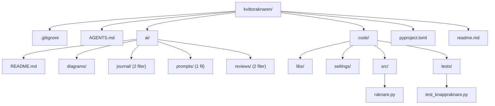
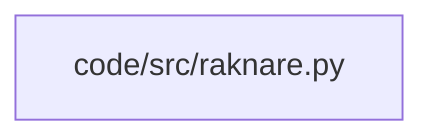
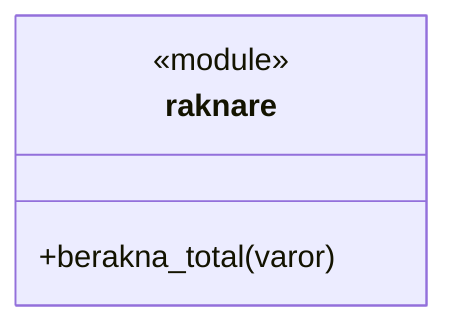
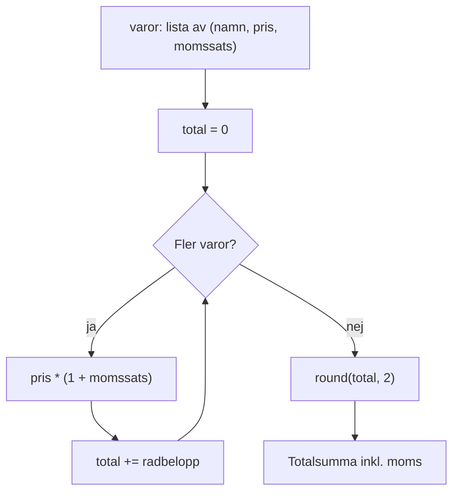
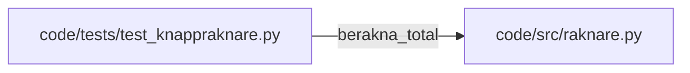
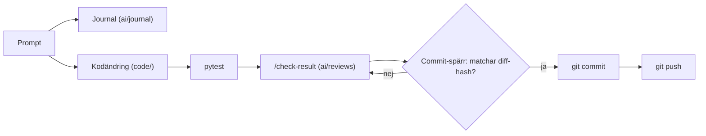
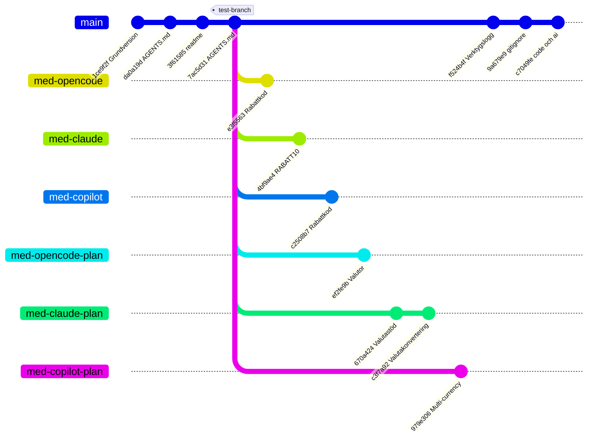

# Diagram – kvittoraknaren

_Genererad 2026-10-30 14:49 med /mermaid._

## Innehåll
- [Katalogstruktur](#katalogstruktur)
- [Modulberoenden](#modulberoenden)
- [Klasser och funktioner](#klasser-och-funktioner)
- [Dataflöde](#dataflöde)
- [Tester](#tester)
- [Arbetsflöde](#arbetsflöde)
- [Brancher](#brancher)

## Katalogstruktur
Projektets mappar och filer: koden ligger i `code/`, AI-materialet i `ai/`.

## Modulberoenden
Vilka moduler som importerar vad. `raknare.py` har inga importer, så den står ensam.

## Klasser och funktioner
Publika funktioner och klasser per modul.

## Dataflöde
Hur `berakna_total` räknar fram kvittots totalsumma inklusive moms.

## Tester
Vilka testfiler som testar vilka moduler och funktioner.

## Arbetsflöde
Hur en ändring går från prompt till GitHub med journal, granskning och commit-spärr.

## Brancher
`main` och övningsbrancherna, där varje AI-verktyg löste samma uppgift (rabattkod resp. valutor) på en egen branch.

